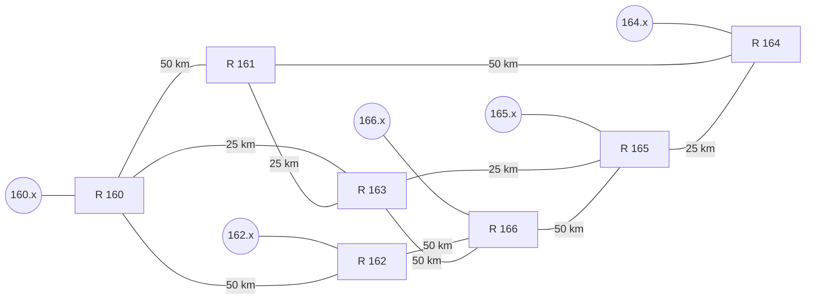

<p align="center">
  
  
  
  
</p>

# Hop-by-Hop IP Routing — OMNeT++ Simulation

**ETSIT · University of Málaga** | **Authors:** _name1_, _name2_
**Course:** Redes y Servicios de Telecomunicación 3 (B.Sc. in Telematics Engineering) · Academic year 2026-27
**Lecturer:** María Carmen España Boquera
**Version:** 1.0 (Practice 1, part 1)

## 📖 Summary

This project is the first part of the lab practices on **data routing in IP
networks and label switching**. Using **OMNeT++ 6.5**, it simulates a network
of **7 routers** and **5 subnets** in which each router decides the next hop
of a packet by looking up its **routing table** (prefix / mask / output port),
following the shortest path in terms of distance.

The practice consists of three exercises: defining the topology in NED,
building the routing tables by hand, and programming the routers' forwarding
logic, verifying it with test packets. Parts 2 (MPLS) and 3 (traffic
engineering and quality of service) are outside the scope of this repository,
although the packet model already reserves their fields.

## 🛠 Requirements

- **OMNeT++ 6.5** (the generated `paqueteIP_m.*` code checks the version)
- C++ compiler bundled with the OMNeT++ installation (MinGW on Windows)
- Project name without spaces (e.g. `practica1a`)
- Provided `package.ned`, which overwrites the one generated when creating the project
- Source files use **ISO-8859-1** encoding; open them with that encoding to display accents correctly

## 📂 Project Structure

```
.
├── package.ned          # NED package (overwrites the generated one)
├── red.ned              # Ex. 1.a: modules, channels and topology
├── omnetpp.ini          # Ex. 1.b: parameters and routing tables
├── router.cc            # Ex. 1.c: forwarding, queues and sending
├── subred.cc            # Packet generation/reception and delay measurement
├── nada.cc              # Sink for unconnected router ports
├── paqueteIP.msg        # IP packet definition
├── paqueteIP_m.h/.cc    # Code generated by opp_msgtool (do not edit)
├── Practica1a.exe       # Release executable (Windows)
├── Practica1a_dbg.exe   # Debug executable (Windows)
└── README.md
```

## 🌐 Topology

Each subnet is connected to a single router. Routers 161 and 163 are
transit-only. Links are point-to-point, symmetric and bidirectional
(155.52 Mbit/s); propagation delay is computed with a group velocity of
2·10⁸ m/s.



| Channel | Use | Length | Prop. delay | Rate |
|---|---|---|---|---|
| `C25` | Router–router | 25 km | 125 µs | 155.52 Mbit/s |
| `C50` | Router–router | 50 km | 250 µs | 155.52 Mbit/s |
| `CRS` | Router–subnet / router–`nada` | 1 km | 5 µs | 1 Gbit/s |

### Subnet–router connections

Each subnet's index follows the order of `prefijosSubredes`
(`"160 162 164 166 165"`) and is connected to the router with the same prefix.

| Subnet | Prefix | Router | Port |
|---|---|---|---|
| `subredes[0]` | 160 | `routers[0]` | 0 |
| `subredes[1]` | 162 | `routers[2]` | 2 |
| `subredes[2]` | 164 | `routers[4]` | 2 |
| `subredes[3]` | 166 | `routers[6]` | 2 |
| `subredes[4]` | 165 | `routers[5]` | 3 |

```
routers[0].puerto[0] <--> CRS <--> subredes[0].puerto;
routers[2].puerto[2] <--> CRS <--> subredes[1].puerto;
routers[4].puerto[2] <--> CRS <--> subredes[2].puerto;
routers[6].puerto[2] <--> CRS <--> subredes[3].puerto;
routers[5].puerto[3] <--> CRS <--> subredes[4].puerto;
```

Unused router ports (R161 p0, R162 p1, R164 p3) are closed with three
`nada` modules (`nadas[0..2]`).

## 🔢 Addressing

**16-bit** addresses: 8 subnet bits + 8 host bits, written as `PPP.HHH`
(e.g. `161.002` = 161×256 + 2 = 41218). Each router's address has host
part 0 (`161.000`). The subnet prefix mask is `/8`; in the tables, masks
range from 0 to 8 bits.

## 🌱 Exercises

### Exercise 1.a — Topology (`red.ned`)
Definition of the `router`, `subred` and `nada` modules, the channels, and
the connections between submodules (`routers[]`, `subredes[]`, `nadas[]`).
When run, OMNeT++ displays the network graph, which is attached to the
report. To avoid traffic in this phase, `modoPrueba` and `modoTrafico` are
set to `false`.

### Exercise 1.b — Routing tables (`omnetpp.ini`)
Network parameters in the `.ini` file (the order of the prefixes must match
the indices of `subredes[]`):

```ini
red.numRouters = 7
red.numSubredes = 5
red.numNadas = 3
red.prefijosSubredes = "160 162 164 166 165"

red.subredes[0].prefijo = 160
red.subredes[1].prefijo = 162
red.subredes[2].prefijo = 164
red.subredes[3].prefijo = 166
red.subredes[4].prefijo = 165
```

Tables filled in by hand using the **shortest path by distance** criterion
(ties broken by fewest hops) and kept as short as possible by grouping rows
with the same output port. They are entered as strings (`tablaPrefijosStr`,
`tablaPuertosStr`, `tablaMascarasStr`), and `cargaTabla()` converts them into
integer vectors.

| Router | Prefix/Mask → Port |
|---|---|
| R160 | 160/8→0 · 161/8→3 · 162/8→1 · 163/8→2 · 164/6→2 |
| R161 | 164/8→3 · 160/8→1 · 162/8→1 · 163/8→2 · 164/6→2 |
| R162 | 162/8→2 · 162/6→0 · 164/6→3 |
| R163 | 161/8→0 · 166/8→2 · 160/6→1 · 164/7→3 |
| R164 | 161/8→0 · 164/8→2 · 160/6→1 · 164/6→1 |
| R165 | 162/8→2 · 164/8→0 · 165/8→3 · 166/8→2 · 160/6→1 |
| R166 | 162/8→1 · 166/8→2 · 160/6→0 · 164/7→3 |

> **Longest-prefix match** is applied, so an aggregated route (`/6`, `/7`)
> coexists with more specific routes (`/8`).

### Exercise 1.c — Packet forwarding (`router.cc`)
Completed functions:

- `buscaTablaEncaminamiento(int direccion)`: returns the output port by
  applying the mask (via `conversionMascara`) and choosing the most specific
  match.
- `encaminaPaquete(paqueteIP *pk)`: follows the flow chart from the
  assignment. If the destination is the router's own address or the special
  address (`224.001`), the packet is processed and not forwarded; otherwise
  the table is consulted and the packet is sent according to its service type.
- `enviarPaquete(...)`: if the channel is busy, the packet waits in one of
  the **two queues per port** (high and low priority). The high-priority
  queue is always served first. If the queue is full (`tamanoMaxCola`), the
  packet is dropped and the overflow is recorded.

**Verification:** in **test mode**, a single packet is sent from
`estacionEmisora` to `estacionDestino`. The console (`EV`) shows the routers
traversed, the output port, the accumulated delay and the packet size. The
total delay must match the manual calculation: transmission + propagation on
each link (+ queuing, if any).

## ▶️ Usage

### From the OMNeT++ IDE
1. `File → New → OMNeT++ Project → Empty project` (e.g. `practica1a`).
2. Copy the files from this repository into the project directory
   (using the file explorer, not the IDE).
3. `Project → Build Project`.
4. `Run as → OMNeT++ Simulation` and choose the **`red`** configuration.

### Testing a route (test mode)
Edit in `omnetpp.ini`:

```ini
red.modoPrueba = true
red.modoTrafico = false
red.estacionEmisora = "162.001"
red.estacionDestino = "164.002"
red.tipoServicioPrueba = 0      # 0 = low priority, 1 = high priority
```

According to the assignment, the packet is generated from 60 s of simulation
time onwards (the current code waits 80 s, see notes).

### Command line
```bash
opp_makemake -f --deep -o Practica1a
make
./Practica1a -u Cmdenv -c red omnetpp.ini
```

## 📊 Results

- **Test tables** (one per test): source and destination stations, packet
  size, routers traversed with their output port and accumulated delay, and
  total delay.
- **Manual verification** of the delay on at least two routes.
- Result vectors (`.vec`) for traffic studies (later parts):
  `RetardoDeSubred<src>Hasta<dst>[P]` and `R<prefix>ProbDesbordamientoPto<n>`.

## ⚠️ Notes

- The table strings are read by fixed positions: ports and masks are
  **one digit**, prefixes **three digits**, separated by **a single space**.
- **Traffic mode is not used** in this part of the practice.
- The `FECprefijo`, `FECmascara`, `etiquetaElegida` and `camino[]` fields and
  the HELLO/MAPPING/PATH/RESV packet types are reserved for MPLS (part 2).
- `paqueteIP_m.*` is regenerated automatically on build.

## 📦 Deliverables

For each stage, the completed files are submitted together with a report
containing the network graph, the created and loaded tables, and the test
tables with the delay analysis.
